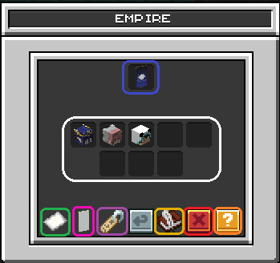
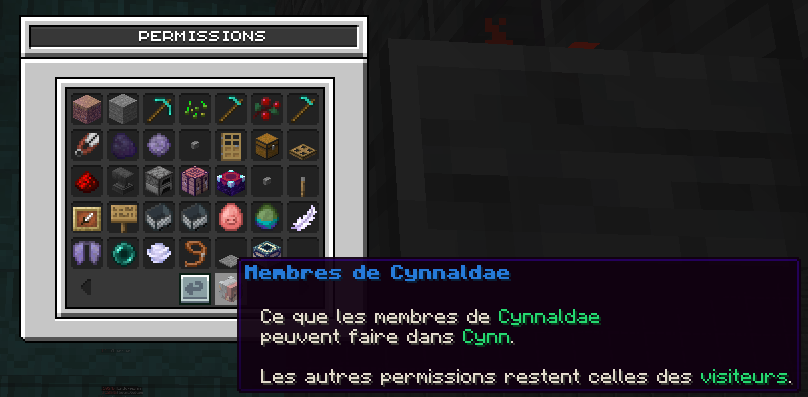

## 🪙Prérequis

Pour pouvoir créer ou rejoindre un Empire, il faut que le maire soit **Gouverneur**. Il faut que la ville ait au minimum 400 claims et 1M dans la banque.

<Danger>
  &#x20;Les frais ne seront pas remboursés lors de la dissolution de l'empire.
</Danger>

---

## 💎Avantages

En créant un Empire, tu pourras désormais relier les chunks des différentes villes qui le composent. Tu bénéficieras également de **50 chunks supplémentaires**, en plus de la limite initiale.

En rejoignant un Empire, tu auras aussi la possibilité de **disposer de permissions** au sein des **autres villes** qui le composent.

---

## 📋Menu&#x20;

Tu peux accéder au menu des Empires via le `/empire`. Dans ce menu, tu y retrouveras toutes les villes faisant partie de l'Empire. Chaque icones correspond à :

**Empire** : Informations sur l'empire

- **Villes de l'empire** : Nombre de villes appartenant à l'empire et la capitale
  - Dans les villes tu peux :
    - Définir les permissions de chaque ville
    
    - Transférer l'empire
    - Exclure de l'empire

* **Inviter une ville**
* **Bannière de l'empire&#x20;**: Changer la bannière
* **Renommer l'empire**
* **Canal de l'empire****&#x20;**: \[Activer] ou \[Désactiver] le canal chat
* **Dissoudre l'empire&#x20;**: supprimer l'empire
* **Informations**

## 🕹️Commandes

**/empire accept&#x20;**: accepter une invitation.

**/empire banner&#x20;**: changer la bannière de l'Empire.

**/empire chat&#x20;**: activer/désactiver le chat de l'Empire.

**/empire create** : créer un Empire.

**/empire deny** : refuser une invitation à rejoindre un Empire.

**/empire disband&#x20;**&#x20;: supprimer un Empire.

**/empire info \[nom de l'Empire]** : afficher les informations d'un Empire.

**/empire invite \[pseudo]&#x20;**: invite un joueur à rejoindre un Empire.

**/empire leave** : quitter un Empire.

**/empire kick \[pseudo]** : expulser un joueur.

**/empire rename** : renommer l'Empire.

**/empire setspawn** : définir le point de spawn de l'Empire.

**/empire spawn** : se téléporter au spawn de l'Empire.

**/empire transfer \[pseudo]&#x20;**: tranférer la propriété de l'Empire.
