Pour pouvoir accèder à ce donjon, tu dois avoir **une classe au niveau 20&#x20;**&#x65;t tu devras fabriquer la **clé** :

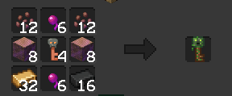

Ensuite, dirige toi au spawn et saute dans le portail !

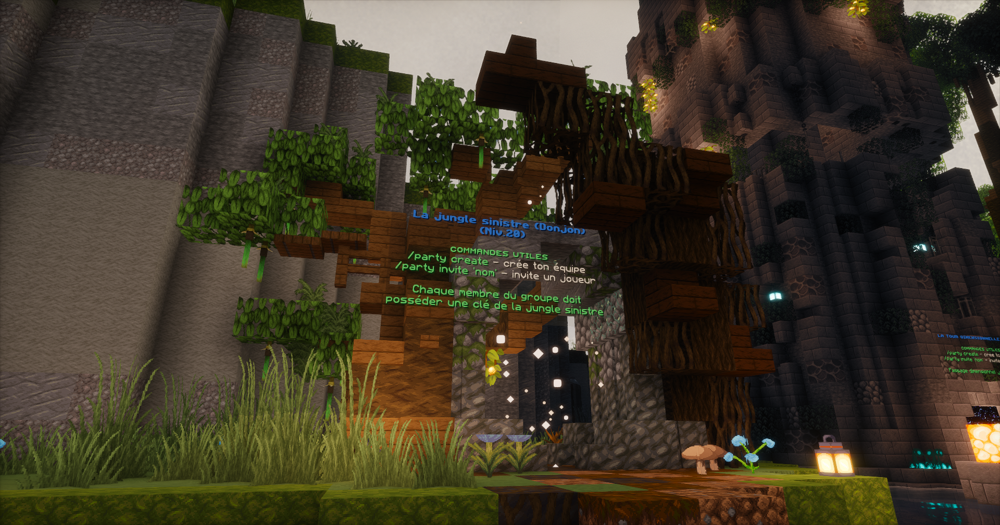

### 🪙 Loots des mobs

🌟 Voici l'obtention de chaque items :

<AccordionGroup>
  <Accordion title="Voir les loots">
     **Tibia d'Embourbé&#x20;**→ Tuer un embourbé

     Gelée Verte → Tuer un slime

     Oeil de Glaron → Tuer un glaron

    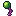 Oeil d'araignée Venimeuse → Tuer une araignée Venimeuse

     Peau d'ocelot → Tuer un ocelott

     Cerveau de zombie villageois → Tuer un zombie villageois

     Pousse de l'arbre monde → Tuer le boss
  </Accordion>
</AccordionGroup>

<Note>
  Les vases te permettent d'obtenir des loots. Clique droit trois fois dessus et tu pourras obtenir de l'argent, des parchemins, des loots de mobs ou bien des Fragment d'étoile.
</Note>

### 🪓 Crafts

Grâce aux **nombreux loots** que tu peux obtenir en faisant le donjon, tu pourras y **crafter des équipements**.

_Vous retrouverez également les crafts dans le /recipe (/recette) en jeu._

<Tabs>
  <Tab title="Armure">
    <Table widths=",137,172,">
      | **🏷️ Nom**                                                                                                               | **📷 Image**                                                            | **📋 Craft**                    | **📊 Stats**                                                                                             |
      | ------------------------------------------------------------------------------------------------------------------------- | ----------------------------------------------------------------------- | ------------------------------- | -------------------------------------------------------------------------------------------------------- |
      | Casque Embourbé (Niv. 24)             |              | 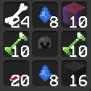 | **🏋️ Résistance :** **0.25 à 0.40** **❤️ Vie :** **9.50 à 15.50**                                       |
      | Casque Embourbé (Niv. 26)             |  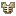        | 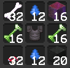 | **🏋️ Résistance :** **0.35 à 0.85** **❤️ Vie :** **14.50 à 20.50**                                      |
      | Jambières Embourbé (Niv. 25)          |            | 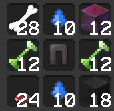 | **🏋️ Résistance :** **0.30 à 0.75** **❤️ Vie :** **8.50 à 14.50**                                       |
      | Bottes Embourbé (Niv. 25)             |  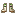             | 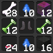 | **🏋️ Résistance :** **0.25 à 0.40** **❤️ Vie :** **10.00 à 16.00**                                      |
      | Plastron Gardien de la Forêt (Niv 30) | 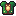 | 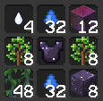 | **🏋️ Résistance :** **0.60 à 1.00** **❤️ Vie :** **13.50 à 19.50** **🛡️ Bouclier :** **12.50 à 22.50** |
    </Table>
  </Tab>

  <Tab title="Autre">
    <Table widths="226,137,205,">
      | **🏷️ Nom**                                                                                                               | **📷 Image**                                                            | **📋 Craft**                     | **📊 Stats**                                                                                                                               |
      | ------------------------------------------------------------------------------------------------------------------------- | ----------------------------------------------------------------------- | -------------------------------- | ------------------------------------------------------------------------------------------------------------------------------------------ |
      | Anneau araignée venimeuse (Niv. 23)   |           |  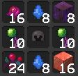 | **🤺Dégâts :&#x20;**&#x20;**9.50 à 12.50**                                                                                                 |
      | Ceinture de l'ocelot (Niv. 21)        |                |  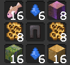 | **🏋️ Résistance :** **0.50 à 0.90** **❤️ Vie :** **9.00 à 14.00**                                                                         |
      | Anneau Glare (Niv. 27)                |               |   | **🤺Dégâts :** **12.00 à 17.00** **🍃Vitesse :&#x20;**&#x20;**1.10 à 1.70**                                                                |
      | Idole Slime (Niv. 28)                 |                |  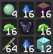 | **🤺Dégâts compétences 2 :&#x20;**&#x20;**7.00 à 10.00** **🍃 Vitesse :&#x20;**&#x20;**1.00 à 1.50**                                       |
      | Amulette Zombie Villageois (Niv 25)   |     | 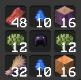  | **🤺Dégâts :** **8.00 à 12.00** **🍃Vitesse :&#x20;**&#x20;**1.20 à 1.80**                                                                 |
      | Plastron Gardien de la Forêt (Niv 30) |  |   | **🏋️ Résistance :** **0.40 à 0.70** **❤️ Vie :** 6.00 à 10.00 🤺 **Dégâts :&#x20;**&#x20;**0.40 à 0.70** **🍃 Vitesse :** **1.80 à 2.50** |
    </Table>
  </Tab>
</Tabs>
