### 📃Introduction aux fournitures

Pour donner une touche unique à tes constructions, le serveur intègre une multitude de meubles 3D ! Ces éléments sont purement cosmétiques et sont parfaits pour décorer ta base, aménager les pièces de ton shop ou rendre ton warp unique.

<Carousel>
  <Slide title="Fournitures en Acacia">
    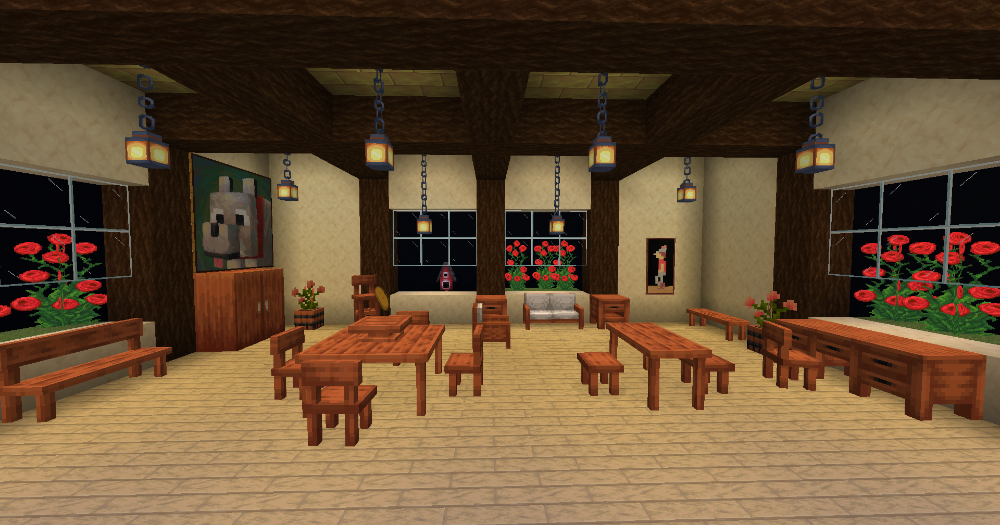
  </Slide>

  <Slide title="Fournitures en Bambou">
    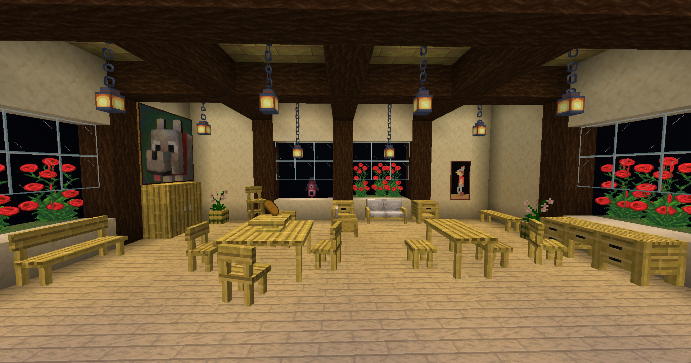
  </Slide>

  <Slide title="Fournitures en Bouleau">
    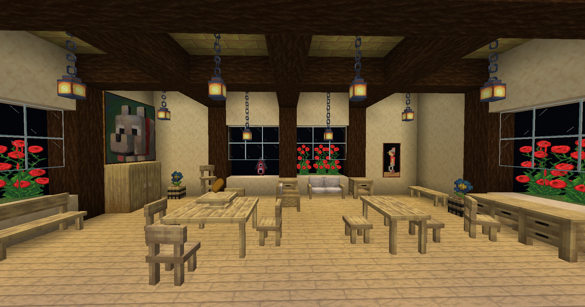
  </Slide>

  <Slide title="Fournitures en Cerisier">
    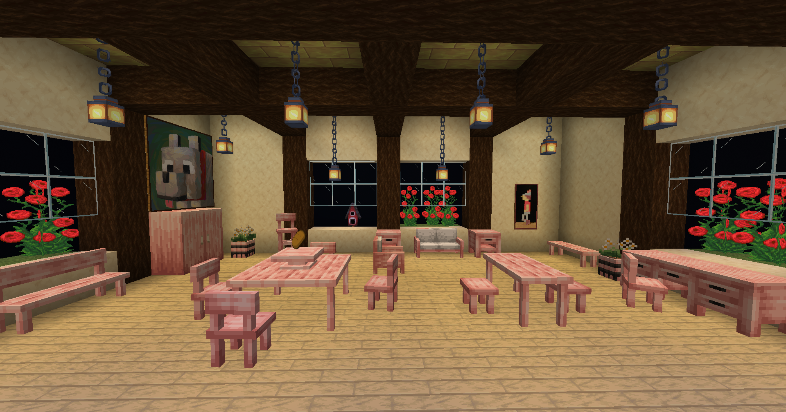
  </Slide>

  <Slide title="Fournitures en Bois écarlate">
    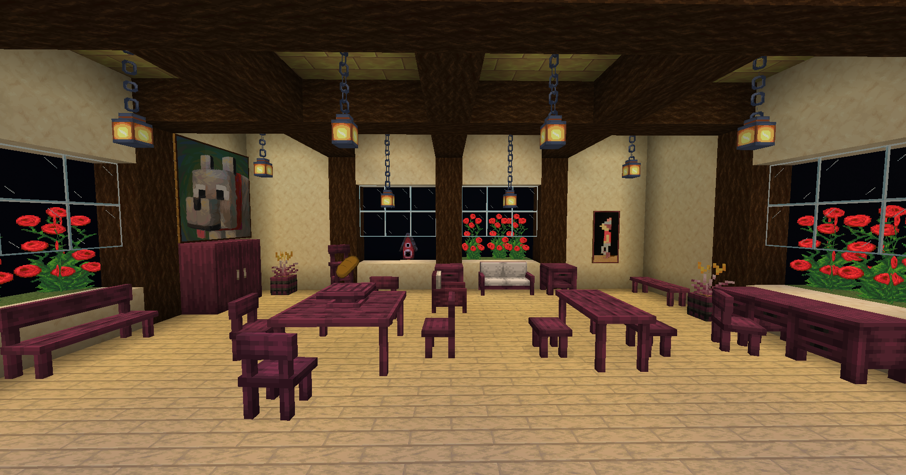
  </Slide>

  <Slide title="Fournitures en Chêne Noir">
    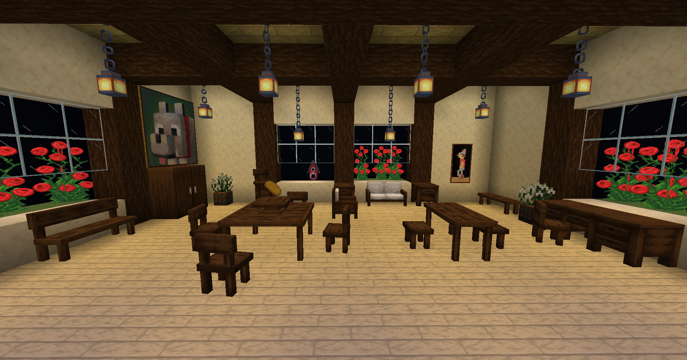
  </Slide>

  <Slide title="Fournitures en Acajou">
    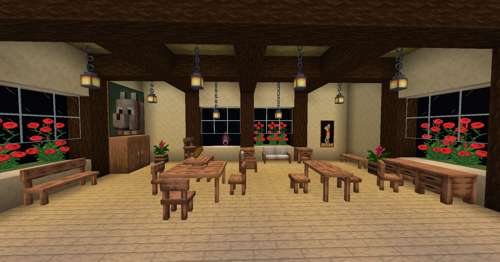
  </Slide>

  <Slide title="Fournitures en Palétuvier">
    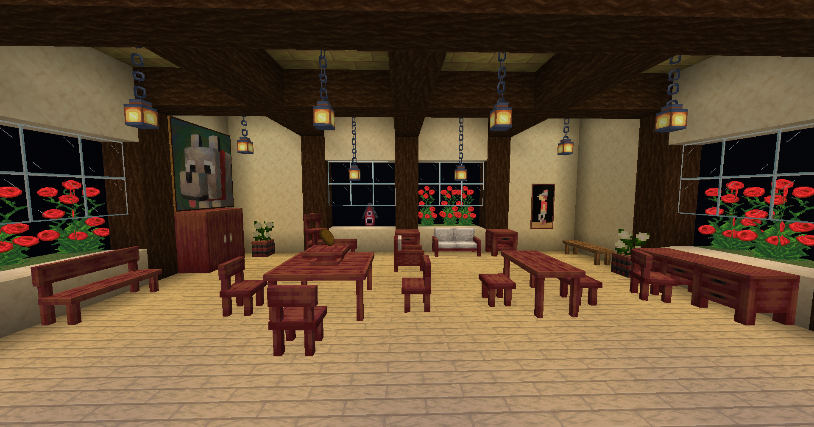
  </Slide>

  <Slide title="Fournitures en Chêne">
    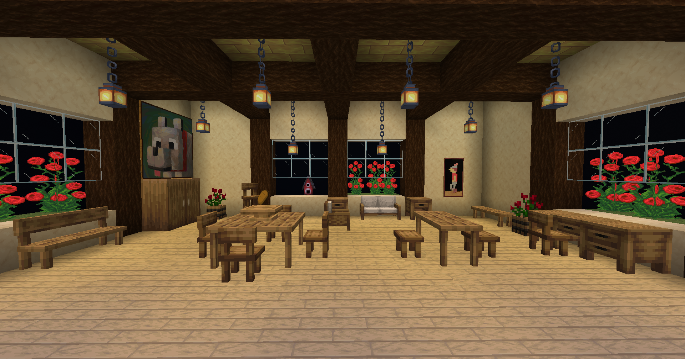
  </Slide>

  <Slide title="Fournitures en Sapin">
    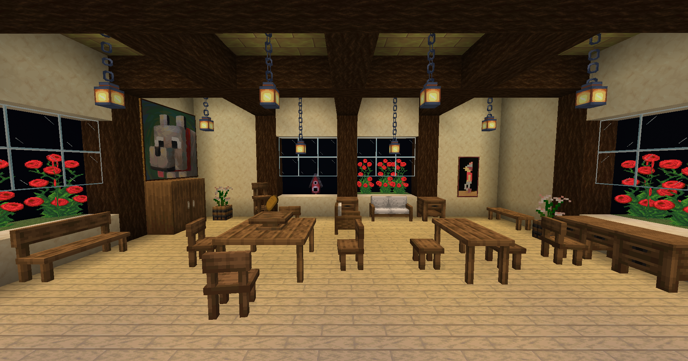
  </Slide>

  <Slide title="Fournitures en bois biscornu">
    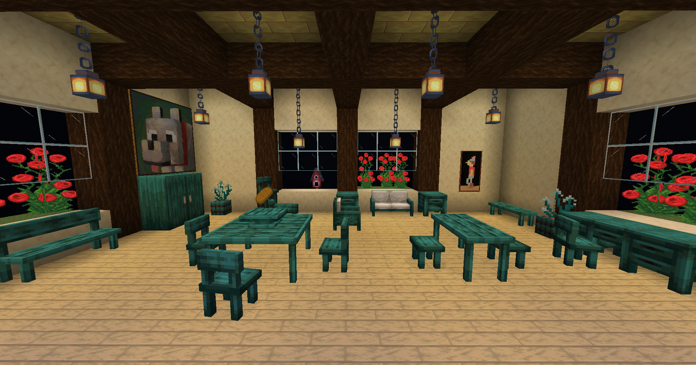
  </Slide>

  <Slide title="Fournitures en Chêne Pâle">
    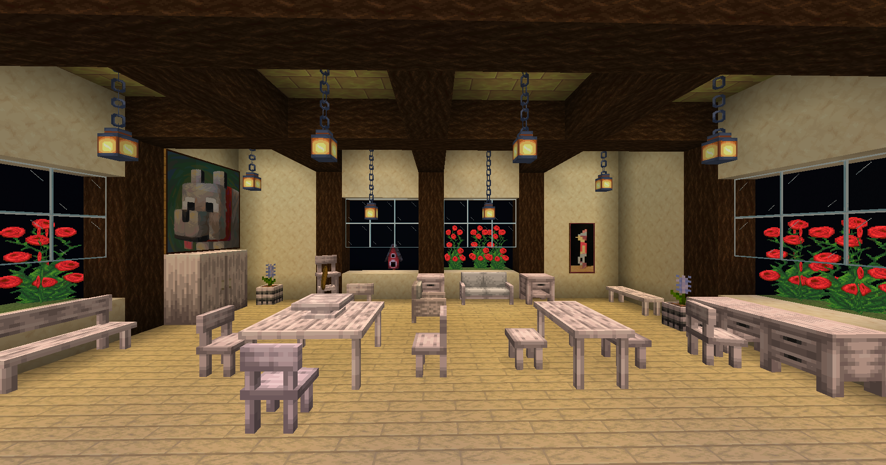
  </Slide>

  <Slide title="Fournitures en Peuplier">
    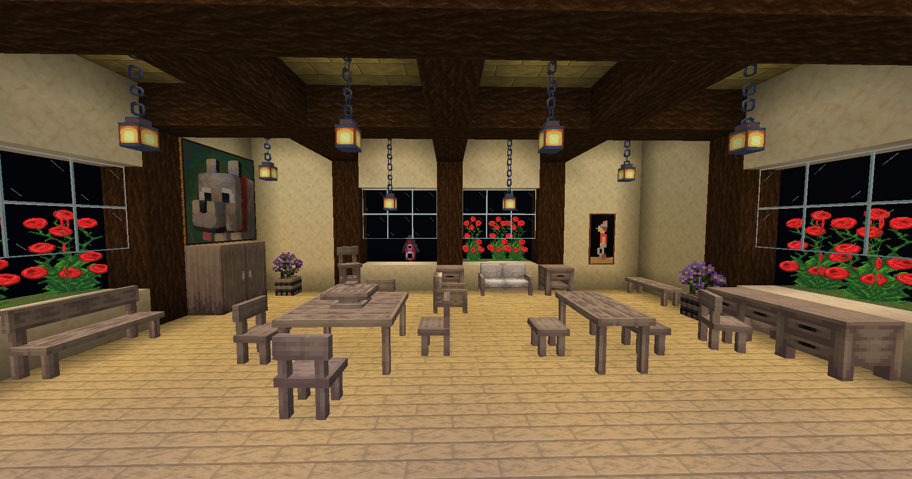
  </Slide>
</Carousel>

Chaque fourniture de cette liste dispose d'un large choix de variantes à découvrir grâce aux différents Blueprints !
Chaque craft d'une variante doit se faire avec le bloc correspondant ! (Chaise en bois de chêne -> craft avec des planches de chêne)

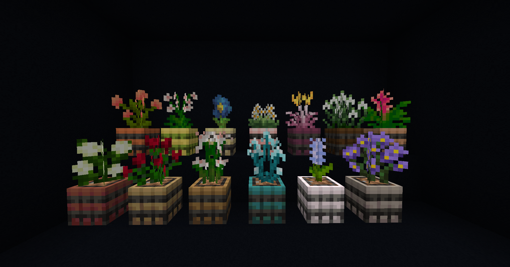

### 🔎Comment les obtenir ?

Pour fabriquer ces fournitures, tu vas devoir partir à l'aventure ! Rends-toi dans le Monde Ressource pour tenter de dénicher des **Blueprints** (plans de fabrication) cachés. Attention, chaque Blueprint est unique : il te permettra de débloquer le craft d'une seule variante spécifique d'un objet. À toi d'explorer le monde pour collectionner tous les plans et créer la décoration de tes rêves !

Chaque Blueprint te permet de débloquer le craft d'une variante spécifique d'un objet. Pas d'inquiétude : une fois le Blueprint trouvé et appris, le craft est débloqué **définitivement** ! Tu pourras ensuite fabriquer ce meuble dans la quantité que tu souhaites pour parfaire tes décorations. À toi d'explorer le monde pour collectionner tous les plans !

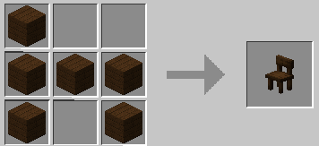

### Visuels et crafts

<AccordionGroup>
  <Accordion title="🌹Pot de Fleur">
    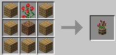

    <Danger>
      Il faut obligatoirement un bloc de terre pour craft le pot de fleur.
    </Danger>

    Fleur nécessaire par type de bois :

    - Chêne : Rosier
    - Bouleau : Bleuet
    - Sapin : Lilas
    - Acajou : Torche-fleur
    - Acacia : Tulipe orange
    - Chêne noir : Muguet
    - Chêne pale : Oeilchidée ouverte
    - Palétuvier : Pivoine
    - Cerisier : Fleurs sauvages
    - Tulipier : Allium
    - Bambou : Orchidée bleue
    - Bois écarlate : Racines carmin
    - Bois biscornu : Racines biscornues
  </Accordion>

  <Accordion title="🐦 Nichoir">
    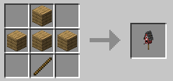
  </Accordion>

  <Accordion title="💺 Chaise">
    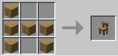
  </Accordion>

  <Accordion title="🍽️ Grande Table">
    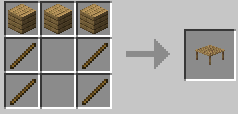
  </Accordion>

  <Accordion title="🍽️ Table">
    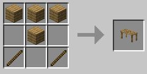
  </Accordion>

  <Accordion title="🗄️ Commode">
    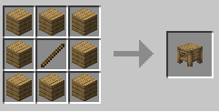
  </Accordion>

  <Accordion title="🗄️ Armoire">
    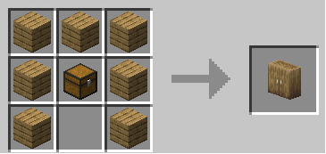
  </Accordion>

  <Accordion title="🏆 Piédestal">
    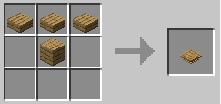
  </Accordion>

  <Accordion title="🛋️ Canapé">
    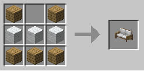

    <Danger>
      Il faut obligatoirement une laine blanche pour craft le canapé.
    </Danger>
  </Accordion>

  <Accordion title="💺 Fauteuil">
    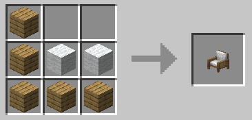

    <Danger>
      Il faut obligatoirement une laine blanche pour craft le fauteuil.
    </Danger>
  </Accordion>

  <Accordion title=" 🏞️Banc">
    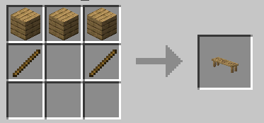
  </Accordion>

  <Accordion title=" 🏞️Banc avec dossier">
    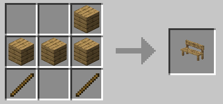
  </Accordion>

  <Accordion title=" 🪑Tabouret">
    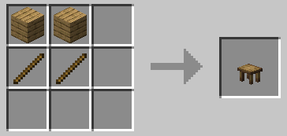
  </Accordion>

  <Accordion title=" 🪑Chaise haute">
    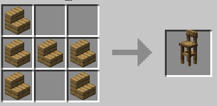
  </Accordion>

  <Accordion title="💻 Bureau">
    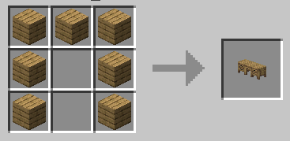
  </Accordion>
</AccordionGroup>
