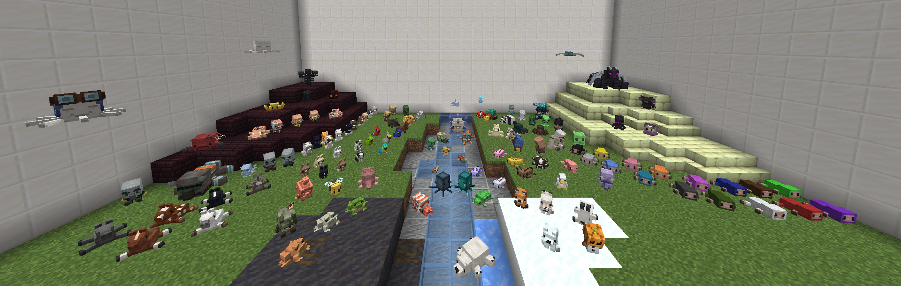
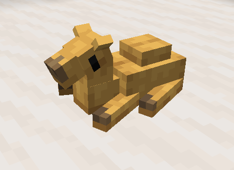
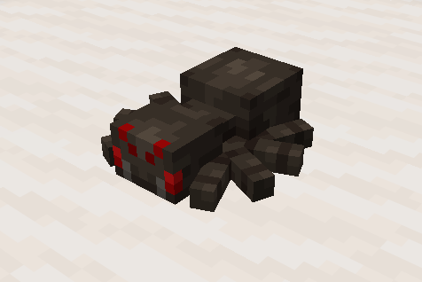
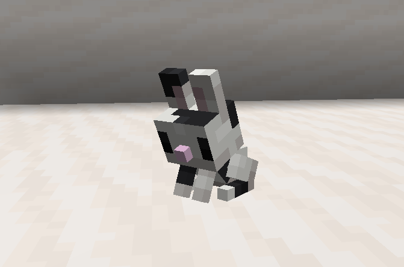
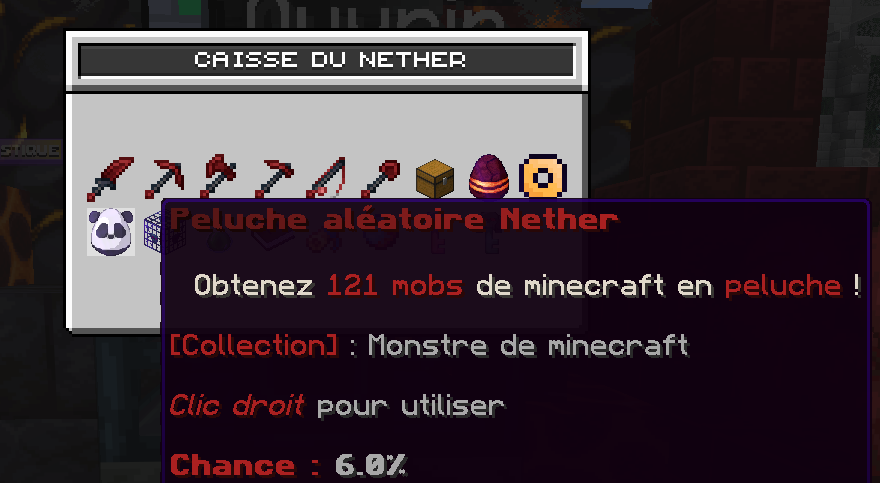

Les **peluches** sont des **objets de décoration** ou de **collection**.\
Elles n'ont pas d'utilité particulière en dehors d'être des **objets de valeur**.

---

## 🧸 Diversité de peluches

Il existe **autant de peluches que de créatures sur Minecraft**. Que la créature soit passive, neutre ou agressive, elle existe dans sa version **peluche** !

<Note>
  Il existe plus d'une centaine de **peluches différentes** sur le serveur !
</Note>

🎨 **La diversité de peluche** ne s'arrête pas qu'aux créatures, car **certains animaux existent également avec plusieurs variations de couleurs** (comme les moutons, perroquets, lapins...).

**La taille des peluches varie** aussi en fonction de la **taille réelle des créatures du jeu**.

Les peluches sont **posables au sol ou sur des blocs**. Tu peux donc t'en servir de **décoration** dans tes créations.

🔁 Si tu es perfectionniste, tu peux **faire tourner les peluches de 45°** en utilisant la touche pour _t'accroupir + clic gauche_.

---

## 🐣 Obtention

🧰 Pour obtenir une peluche, tu devras gagner dans la [Caisse du Nether](https://wiki.astralrealms.fr/store/crates#-caisse-du-nether) une **Peluche aléatoire Nether** (_6.92% de chance_).

**➜** Avec la peluche aléatoire, **tu peux obtenir n'importe laquelle** des **121 peluches**. Chaque créature du jeu **à la même chance d'être obtenue** (0.83% de chance).

**➜** Pour les créatures avec des variations, **chaque variation compte comme une créature unique** avec un taux de d'obtention **égal à toutes les autres créatures**.

<Note>
  Le taux d'obtention des variations d'animaux **est égal au taux d'obtention global des créatures**. Obtenir les variations d'animaux est donc **aussi rare** que l'obtention d'une autre créature.
</Note>

💵 À défaut, pour **obtenir tes peluches et perfectionner ta collection**, tu pourras alors **acheter des peluches aux autres joueurs**, notamment dans l'[AH](https://wiki.astralrealms.fr/economy/ah).

---

🐮 **Les peluches** sont des objets de **valeur**, en lien avec leur **rareté**.\
**➜** Si tu souhaites **les voir sous toutes leurs formes**, rends toi en jeu et **découvre par toi-même ces mignoneries** !

🏆 **Collectionneurs ou décorateurs, adoptez vos peluches puis exposez les au monde, pour notre plus grand bonheur !**
