### 📌 Rôles par défaut

À la création de la ville, il existe 3 rôles par défaut.

| Rôle            | Attribution                       | Description                              |
| --------------- | --------------------------------- | ---------------------------------------- |
| 👤 **Adjoint**  | Par le **maire**                  | Rôle de gestion avec permissions élevées |
| 🏘️ **Membre**  | **Automatique** à l’entrée        | Rôle standard des habitants              |
| 🌍 **Visiteur** | Joueurs **extérieurs** à la ville | Accès limité                             |

### 🗒️Création de Rôles

Cependant, tu peux créer tes propres rôles.\
Ouvre le menu des rôles avec la commande `/v roles`

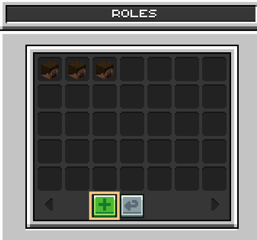

- **🟠 Orange**\
  ➜ Appuie sur l'icône ➕ et crée le rôle.

##### **Présentation du menu de création de rôle**

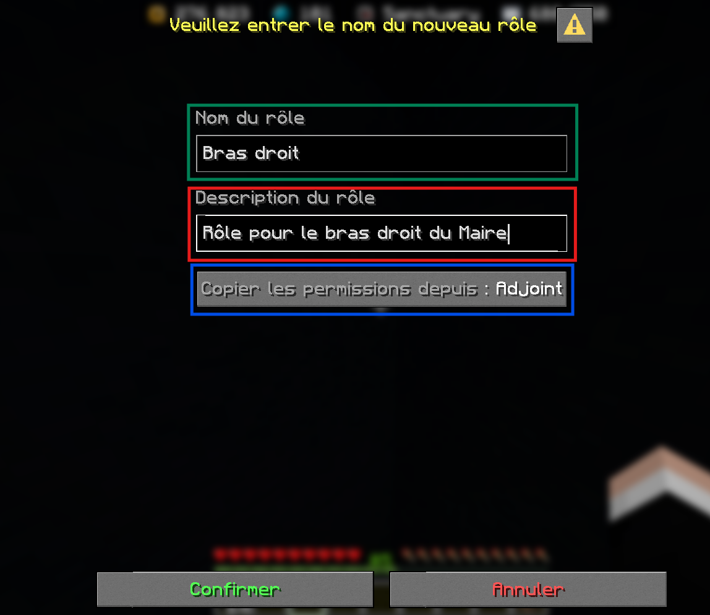

- **🟢 Vert**\
  ➜ Choisis le nom du rôle.

- **🔴 Rouge**\
  ➜ Écris une description pour le rôle.

- **🔵 Bleu**\
  ➜ Copie les permissions déjà définies d'un autre rôle.

**Après** avoir remplis les cases, il faut juste **cliquer** sur **Confirmer** et le rôle sera **crée** !

### 🖋️ Permissions

Lorsque tu es dans le menu `/v roles `et que tu sélectionnes l'icône d’un rôle, tu peux configurer les permissions associées à ce rôle pour les joueurs qui le possèdent.

<Carousel>
  <Slide>
    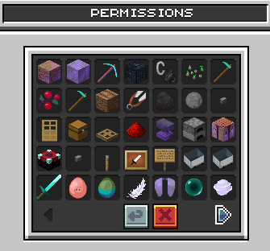
  </Slide>

  <Slide>
    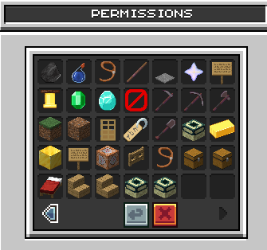
  </Slide>
</Carousel>

<Danger>
  Nécessite la permission "Modifier des permissions".
</Danger>

<AccordionGroup>
  <Accordion title="🏘️ Interaction avec la ville">
    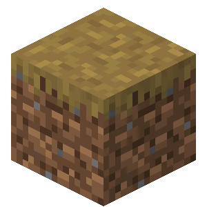  **Rentrer dans la ville** : permet de pénétrer dans la ville.

    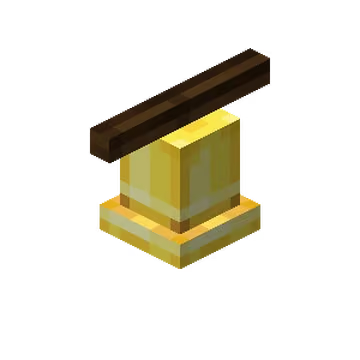 **Envoyer des annonces** : permet d'envoyer des annonces à tous les membres de la ville.

    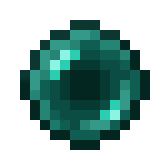 **Autoriser la téléportation** : permet d'autoriser ou non la téléportation dans la ville.

    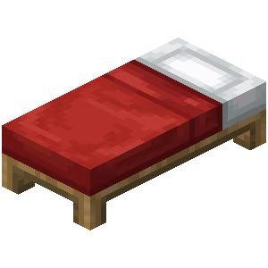 **Créer un home** : permet de définir un point de téléportation /home dans la ville.

    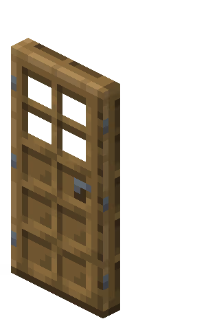**Définir le point de spawn** : permet de définir le point d'apparition de la ville.

    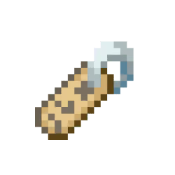**Changer le nom de la ville** : permet de modifier le nom de la ville.

    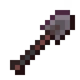**Changer les paramètres de ville** : permet de modifier les paramètres de la ville.

    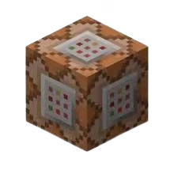**Voir le journal d'activité** : permet de consulter le /v logs dans la ville.
  </Accordion>

  <Accordion title="⛏️ Construction">
    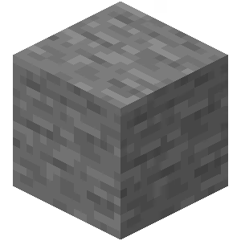 **Placer des blocs** : permet de poser des blocs.

    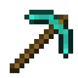 **Casser des blocs** : permet de détruire des blocs.

    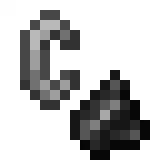 **Brûler des blocs** : permet de mettre le feu.

    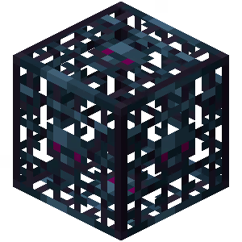 **Casser des spawners** : permet de détruire les spawners.

    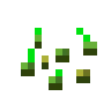 **Planter des cultures** : permet de planter des cultures.

    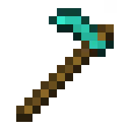 **Récolter des cultures** : permet de récolter des cultures.

    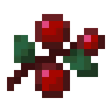 **Récolte des cultures au clic droit** : permet de récolter des cultures via un clic droit.

    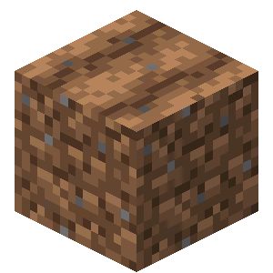 **Bêcher le sol** : permet de bêcher le sol.

    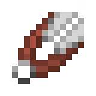 **Tondre des moutons** : permet de tondre les moutons.

    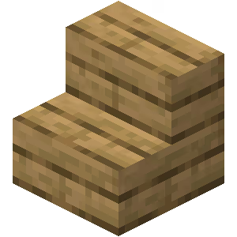 **Placer des meubles / peluches** : permet de poser des meubles ou des peluches décoratives.

     **Casser des meubles / peluches** : permet de détruire des meubles ou des peluches décoratives.\

  </Accordion>

  <Accordion title="🔧 Items & interactions ">
    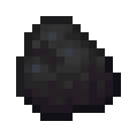 **Ramasser des items** : permet de ramasser des objets au sol.

     **Jeter des items** : permet de jeter des objets au sol.

    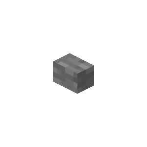 **Interagir** : permet d'interagir avec les éléments de la ville (boutons, leviers, portes,...).

    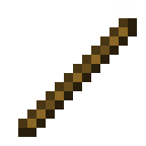 **Utiliser le debug stick** : permet d'utiliser le bâton de débogage.

     **Utiliser des portes** : permet d'ouvrir et fermer les portes.

    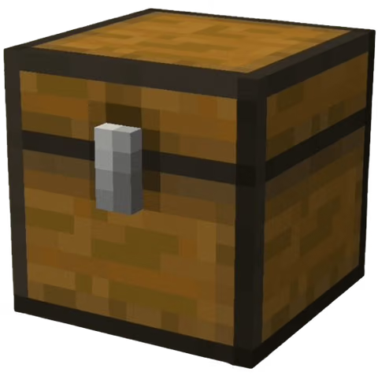 **Utiliser des conteneurs** : permet d'ouvrir coffres, barils et autres conteneurs.

    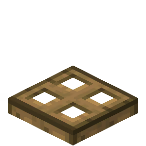 **Utiliser des trappes** : permet d'ouvrir et fermer les trappes.

    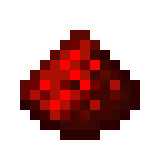 **Utiliser de la redstone** : permet d'interagir avec la redstone.

    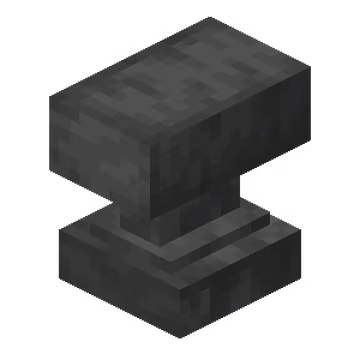 **Utiliser des enclumes** : permet d'utiliser les enclumes.

    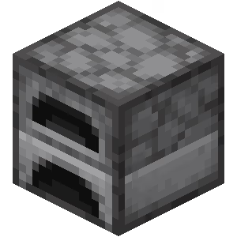 **Utiliser des fours** : permet d'utiliser les fours.

    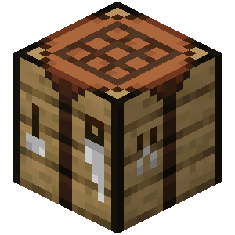 **Utiliser des tables de craft** : permet d'utiliser les tables de craft.

    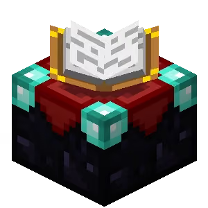 **Utiliser des tables d'enchantement** : permet d'utiliser les tables d'enchantement.

    **Utiliser des boutons** : permet d'utiliser les boutons.

    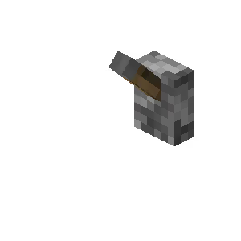**Utiliser des leviers** : permet d'utiliser les leviers.

    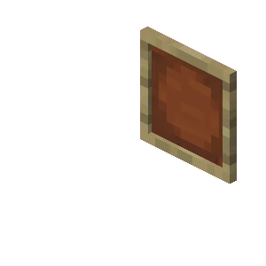 **Utiliser des cadres** : permet d'interagir avec les cadres.

    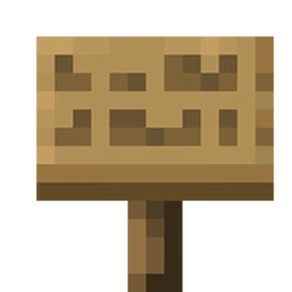 **Éditer une pancarte** : permet de modifier le texte d'une pancarte.
  </Accordion>

  <Accordion title="🚤 Véhicules & déplacements">
    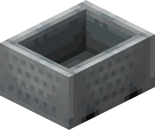 **Poser des véhicules** : permet de poser des véhicules (minecart, bâteau...).

     **Utiliser des véhicules** : permet de monter et conduire des véhicules.

    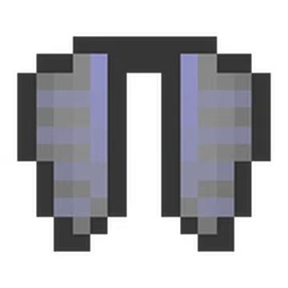 **Utiliser des élytres** : permet d'utiliser des élytres.

    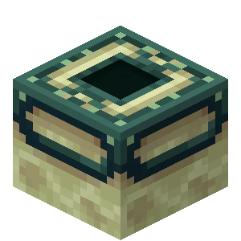 **Utiliser des perles de l'Ender** : permet de se téléporter avec des perles de l'Ender.

    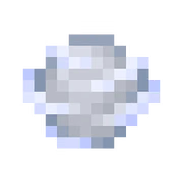**Utiliser un projectile** : permet de lancer des projectiles (boules de neige, charge de vent...).

    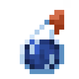 **Jeter des potions** : permet de lancer des potions.

    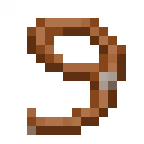 **Utiliser les laisses** : permet d'attacher et détacher des animaux avec une laisse.
  </Accordion>

  <Accordion title="⚔️ Combat & PvE/PvP">
    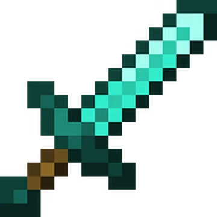 **Tuer des joueurs** : permet de tuer d'autres joueurs.

    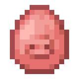 **Tuer des animaux** : permet de tuer des animaux.

    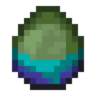 **Tuer des monstres** : permet de tuer des monstres.
  </Accordion>

  <Accordion title="🫂 Gestion de la ville">
     **Inviter des joueurs** : permet d'inviter des joueurs à rejoindre la ville.

    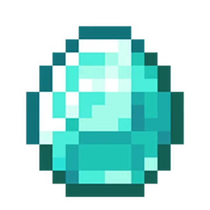 **Exclure des joueurs** : permet d'exclure un joueur hors de la ville.

    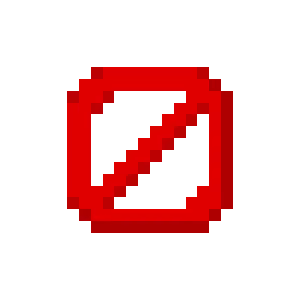 **Bannir des joueurs** : permet de bannir un joueur de la ville.

    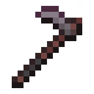 **Gérer les rôles** : permet de créer, modifier ou supprimer des rôles.

    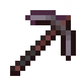 **Assigner des rôles** : permet d'attribuer un rôle à un joueur.

    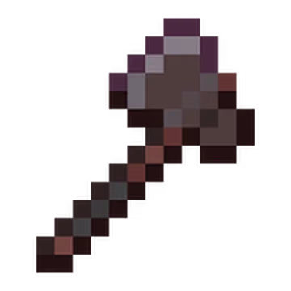 **Modifier des permissions** : permet de modifier les permissions associées à un rôle.

    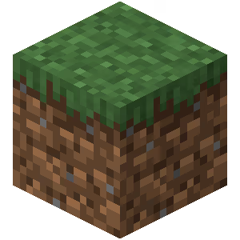 **Claim** : permet de claim un chunk pour la ville.

     **Unclaim** : permet d'unclaim un chunk revendiqué par la ville.

     **Gérer des sous-zones** : permet de créer et configurer des sous-zones dans la ville.

     **Retirer de l'argent de la banque** : permet de retirer de l'argent de la banque de la ville.

     **Déposer de l'argent de la banque** : permet de déposer de l'argent dans la banque de la ville.

     **Créer des boutiques joueurs** : permet de créer une boutique joueur.

     **Utiliser les boutiques joueurs partagées** : permet d'utiliser les boutiques joueurs partagées de la ville.

     **Créer un warp** : permet de créer un warp (/vw).
  </Accordion>

  <Accordion title="💬 Commandes">
     **Utiliser le chat de ville** : permet d'écrire dans le chat réservé à la ville.

     **Utiliser /ase** : permet d'utiliser la commande /ase.

     **Utiliser la commande /top** : permet de se téléporter au point le plus haut.

     **Faire apparaître les familiers (/pets)** : permet de faire apparaître ses familiers.

     **Vol (/fly)** : permet de voler.
  </Accordion>
</AccordionGroup>
