Il existe **différents paramètres** que tu peux soit **activer** soit **désactiver**. Lorsqu'un paramètre est **activé**, il sera **enchanté**.

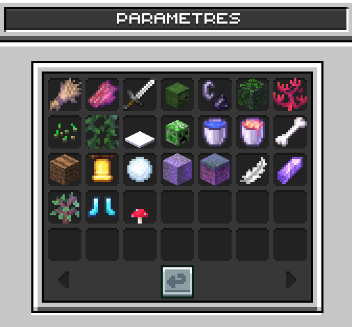

<Danger>
  Nécessite la permission "Changer les paramètres de ville".
</Danger>

<AccordionGroup>
  <Accordion title="👺 Mobs">
    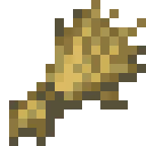 **Apparition des animaux** : permet d'activer ou de désactiver l'apparition des animaux.

    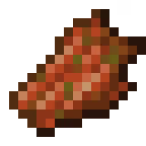 **Apparition des monstres** : permet d'activer ou de désactiver l'apparition des monstres.

    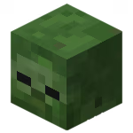 **Dégâts des mobs** : permet d'activer ou de désactiver les dégâts infligés par les mobs.

    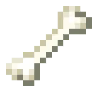 **Butin** : permet d'activer ou de désactiver les butins obtenus en tuant les mobs.
  </Accordion>

  <Accordion title="🫂 Joueurs">
    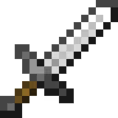 **PvP** : permet d'activer ou de désactiver le PvP.

    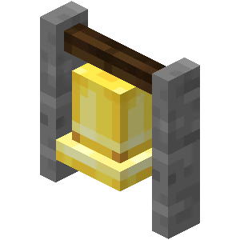 **Notifications des visiteurs** : permet d'activer ou de désactiver les notifications lorsqu'un visiteur arrive dans la ville.

    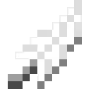 **Dégâts des chutes** : permet d'activer ou de désactiver les dégâts de chutes.

    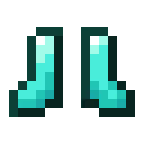**Effet de l'enchantement Gelure** : permet d'activer ou de désactiver les butins obtenus en tuant les mobs.
  </Accordion>

  <Accordion title="🌍 Nature">
    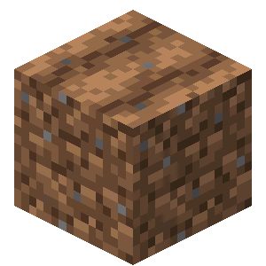 **Piétinement des cultures** : permet d'activer ou de désactiver le piétinement des cultures.

    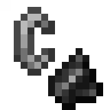 **Propagation du feu** : permet d'activer ou de désactiver la propagation du feu.

    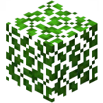 **Décomposition des feuilles** : permet d'activer ou de désactiver la décomposition des feuilles.

    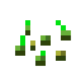 **Croissance des cultures** : permet d'activer ou de désactiver la croissance des cultures.

    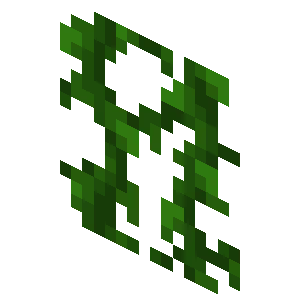**Croissance des lianes** : permet d'activer ou de désactiver la croissance des lianes.

    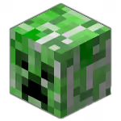 **Dégâts d'explosions** : permet d'activer ou de désactiver les dégâts causés par les explosions.

    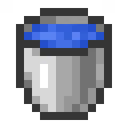 **Mouvement de l'eau** : permet d'activer ou de désactiver le mouvement de l'eau.

    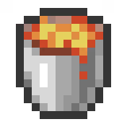 **Mouvement de la lave** : permet d'activer ou de désactiver le mouvement de la lave.

    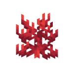 **Mort des coraux** : permet d'activer ou de désactiver la mort des coraux hors de l'eau.

    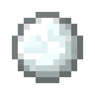 **Fonte des neiges** : permet d'activer ou de désactiver la fonte des neiges.

    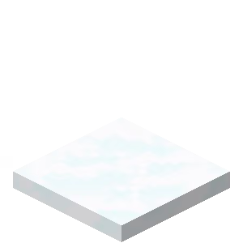 **La neige et la glace ne se forment pas** : permet d'empêcher la formation de neige et de glace.

    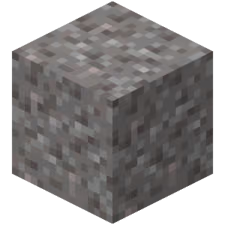 **Activation de la gravité des blocs** : permet d'activer ou de désactiver la gravité des blocs (sable, gravier...).

    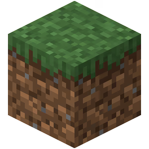 **Propagation de l'herbe** : permet d'activer ou de désactiver la propagation de l'herbe.

    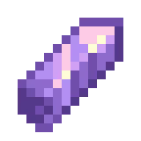**Croissance de l'améthyste** : permet d'activer ou de désactiver la croissance de l'améthyste.

    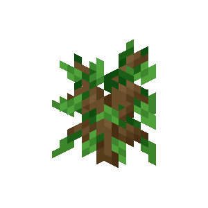**Croissance des arbres** : permet d'activer ou de désactiver la croissance des arbres.

    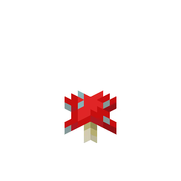**Propagation des champignons** : permet d'activer ou de désactiver la propagation des champignons.
  </Accordion>
</AccordionGroup>
